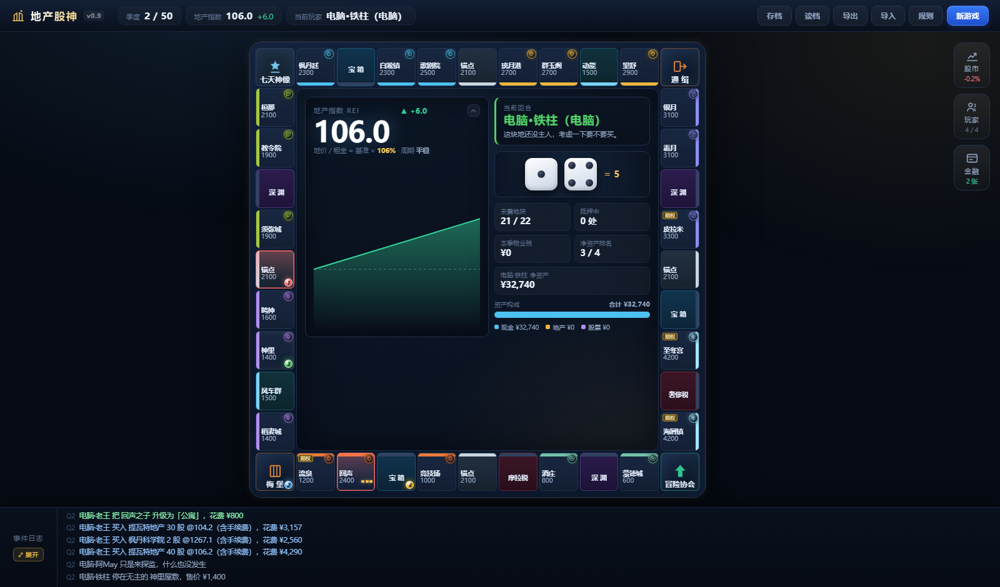

# 地产股神 v0.10 · 提瓦特版

不用纸地图的大富翁：**传统买地收租** + **会周期涨跌的地产市场** + **可以炒的股票市场** + **PDF 里的银行金融产品**。
单机 2~4 人轮流玩，或**各看各屏幕联机**（含异地）。一局会经历好几轮繁荣与崩盘，加杠杆的人可能被银行强制收地。

> **v0.10 新增**：玩家间自由交易（地产 / 股票 / 现金 / 地租分红权）· 破产地产拍卖 · 托管档保守 AI · 12 面骰可选 · 每回合限盖 1 次楼。
> 详细说明见 [`docs/游戏说明.md`](docs/游戏说明.md)；平衡是怎么调出来的见 [`docs/平衡调参记录.md`](docs/平衡调参记录.md)。

> ⚠️ **文档版本说明**：`docs/` 下多数说明写于 v0.9，v0.10 的新机制以代码和本 README 为准，文档正在陆续补齐。

---

## 先看这里

| 我想…… | 看这个 |
|---|---|
| **知道该双击哪个文件** | [`点哪个-先看这个.md`](点哪个-先看这个.md) |
| 学怎么玩、数值怎么算 | [`docs/游戏说明.md`](docs/游戏说明.md) |
| 当房主开一局联机 | [`docs/给主机.md`](docs/给主机.md) |
| 把说明转给朋友 | [`docs/给朋友.md`](docs/给朋友.md) |
| 异地联机（不在同一 WiFi） | [`docs/异地联机指南.md`](docs/异地联机指南.md) |
| 联机原理 / 排错 | [`docs/联机说明.md`](docs/联机说明.md) |
| 了解平衡是怎么调出来的 | [`docs/平衡调参记录.md`](docs/平衡调参记录.md) ｜ [`docs/地租经济学分析.md`](docs/地租经济学分析.md) |
| 看真实对局数据 | [`docs/联机对局数据报告.md`](docs/联机对局数据报告.md) |



---

## 三种玩法（对应三个双击目标）

| 想怎么玩 | **双击这个** |
|---|---|
| 一台电脑，几个人轮流玩 | [`启动-本地热座.bat`](启动-本地热座.bat) |
| 每人一台设备，各看各屏幕（你是房主） | [`启动-联机服务.bat`](启动-联机服务.bat) |
| 朋友在外地 | [`启动-异地联机-cloudflared.bat`](启动-异地联机-cloudflared.bat) |
| 只想打开游戏本体 | [`dist/地产股神.html`](dist/地产股神.html) |

**联机只要求房主那台机器装 Node.js**（<https://nodejs.org> 下 LTS 版），朋友什么都不用装。
异地用的 `cloudflared.exe` 也已经下好放在文件夹里了。

### 单文件热座（最省事）

双击 [`dist/地产股神.html`](dist/地产股神.html) —— **一个文件就是整个游戏**，不含任何外部依赖，可以直接发给朋友（微信 / 邮件 / U 盘都行）。

### 联机（各看各屏幕）

双击 [`启动-联机服务.bat`](启动-联机服务.bat)。它会弹出黑窗口 + 自动开浏览器，黑窗口里打印局域网地址；
其他人打开 → 点「联机对战」→ 输入 4 位房间号。**异地玩法见 [`docs/异地联机指南.md`](docs/异地联机指南.md)。**

### 源码版（想改代码）

双击 [`index.html`](index.html) 也能玩（需要带上 `styles.css` 和 `src/`）。改完跑 `npm run build`。

---

## 操作

| 操作 | 说明 |
|---|---|
| 空格键 | 掷骰子 / 结束回合 |
| `M` / `P` / `F` | 展开 **股市** / **玩家** / **金融产品** 面板（再按一次收起，`Esc` 也可以收） |
| `C` | 折叠棋盘中央那块大面板，空出来的地方显示实时排行榜 |
| `⤢ 展开` | 底栏左侧，把事件日志**铺满整屏**看（`Esc` 收起） |
| 点棋盘格 | 打开详情页：代表角色、地价、各级租金对照、升级 / 抵押 / 赎回 / 卖回银行 |
| 顶栏 | 存档、读档、导出 / 导入 JSON、规则、新游戏（**联机时这几项会锁住**，由房主控制） |

---

## 核心机制

* **地价 = 基准地价 × 等级系数 × 地产指数 ÷ 100**，所以房价会涨会跌。
* **地产指数（REI）** 100 起步，按正弦周期摆动（振幅 ±46 点、周期 16–30 季度）。一局会经历好几轮「繁荣 → 过热 → 崩盘 → 复苏」。
* **001 提瓦特地产的价格就是地产指数**，买卖它等于直接炒房地产行业，而且会**反过来推动地价**。
* **★ 股票先吃滑点再成交 + 双向 1% 手续费**：同一回合内买了再卖必亏约 2.8%，刷差价这条路被从数学上堵死。
* **物业税**：每季度按地产市值的 **1.2%** 收（抵押中减半）。这是"囤地不开发"的持有成本。
* **杠杆追缴**：抵押能拿市值 **60%** 的现金；市值一旦跌破贷款额的 110%，银行发出追缴，一个回合内不赎回就**强制收地、贷款勾销**。
* **5 张金融产品**（来自原 PDF）：风险投资卡、垃圾债券、地产期权合约、租金保险、3 圈定期存单。
* 6 只股票，买卖会推动价格，别人为某行业的地块付租金时该行业股票分红。
* 棋盘按地价由低到高绕一圈：**蒙德 → 纳塔 → 稻妻 → 须弥 → 枫丹 → 璃月 → 挪德卡莱 → 至冬**，凑齐一整个地区才有垄断加成。

### 联机专属规则

| 规则 | 说明 |
|---|---|
| **回合超时** | 掷骰/买地类 **90 秒**、交易阶段 **180 秒**。超时后系统替你执行**最保守动作**（掷骰阶段自动掷、买地自动放弃），**绝不替你花钱** |
| **回合倒计时** | 轮到你时中央面板显示剩余秒数，**剩 30 秒**变琥珀色提醒 |
| **掉线自动托管** | 只有**轮到你、且静默超过 60 秒**才会交给电脑；你回来就立刻交还 |
| **热加入** | 房间已开局但还有电脑座位时，中途来的人可以顶替进去；**掉线者的座位不会被抢** |
| **炒股不绑回合** | 任何人的回合都能买卖股票（例外：自己在坐牢、或有人正在决定买地） |

---

## 换角色头像

每个地块都配好了代表角色（晨曦酒庄→迪卢克、望舒客栈→魈、海屑镇→达达利亚……），默认显示程序生成的元素徽记。
**把图片丢进 [`assets/avatars/`](assets/avatars/) 就自动替换**，文件名对照表见 [`assets/avatars/README.md`](assets/avatars/README.md)。
`npm run build` 打包时会把图片一起内联进单文件版。

---

## 目录结构

```
index.html               页面骨架（源码版入口）
styles.css               全部样式（设计令牌在文件顶部）
src/data.js              ★ 所有可调数值：40 格地名/角色、8 个地区、6 只股票、20 张事件卡、5 张金融产品、CONFIG
src/engine.js            ★ 规则引擎（纯逻辑，Node 和浏览器都能跑）
src/ai.js                电脑玩家（会看周期择时、会躲追缴、会用金融产品）
src/ui.js                界面渲染与交互
src/net.js               联机层：大厅、长轮询收状态、操作上报、掉线认座
src/main.js              启动、开局设置、存读档
server.mjs               ★ 联机服务端（零依赖：静态文件 + 房间 + AI 驱动 + 长轮询 + 超时兜底）
dist/地产股神.html        单文件版（npm run build 生成）
assets/avatars/          角色头像（丢图进去就能用）
saves/                   存档（断线救援用；文件名必须是 ASCII）
```

### 工具

```
tools/build-single.mjs    打包成单文件（会把头像一起内联）
tools/watch.mjs           ★ 实时旁观+录制一局（只读，不影响对局）
tools/report.mjs          把录制变成中文战报
tools/night-report.mjs    汇总所有录制的分析
tools/snapshot.mjs        把进行中的对局存档（断线救援）
tools/tune.mjs            ★ 平衡测试台 + 自动调参
tools/rent-audit.mjs      地租经济性审计
tools/rent-sweep.mjs      物业税 × 租金 参数扫描
tools/thinktime.mjs       统计玩家每步实际耗时（用来定超时秒数）
tools/test-rules.mjs      ★ 规则回归测试（套利、5 张卡、保险、存单……）
tools/test-ui.mjs         jsdom 端到端测试（打满一整局 + 联机路由回归）
tools/test-net.mjs        ★ 联机集成测试（真起服务端跑全流程 + 超时/掉线/热加入）
tools/sim.mjs / dbg.mjs   批量模拟 / 单局调试日志
```

---

## 开发者命令

```powershell
npm install                        # 只装 jsdom（测试用），游戏本身零依赖
npm test                           # 四套测试全跑（规则 + 界面 + 单文件 + 联机）
npm run build                      # 打包成 dist/地产股神.html
npm run lan                        # 起联机服务端

# 平衡
node tools/tune.mjs --games 300    # 用当前 CONFIG 跑 300 局，打印评分卡
node tools/rent-audit.mjs 200      # 地租经济性审计
node tools/thinktime.mjs           # 玩家每步实际耗时分布

# 观战与记录
node tools/watch.mjs [房间号]       # 实时旁观录制（不给房间号就自动找）
node tools/report.mjs              # 录制 → 中文战报
node tools/night-report.mjs        # 汇总所有录制

# 联机调试
DGS_AI_DELAY=25 node server.mjs    # 把电脑每步压到 0.025 秒
DGS_T_ROLL=3 DGS_T_TRADE=3 DGS_GRACE=1500 node server.mjs   # 把超时压到秒级
node server.mjs 8787 --restore "saves/xxx.json" --pay "名字=40000"   # 恢复对局 + 发钱
```

### 后台接口（只允许本机访问，公网隧道过来的会被 403 拒绝）

| 接口 | 用途 |
|---|---|
| `GET /api/rooms` | 列出当前房间 |
| `POST /api/admin/pay` | 给玩家加/减钱，body `{room, name, amount}` |

---

> 本作是给朋友之间小范围玩的非商业同人作品，地名与角色名取自《原神》，与米哈游无关，请勿用于商业用途或公开分发。
