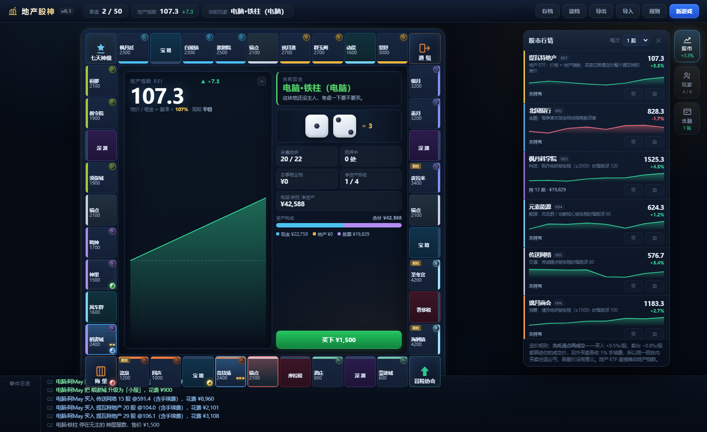

# 《地产股神》游戏说明 v0.9 · 提瓦特版

> 不用纸质地图的大富翁：**传统买地收租** + **会涨会跌的地产市场** + **可以炒的股票市场**。
> 一局设计目标约 2 小时（真人对局实测约 2.9 小时，见第 1 节），中途会经历好几轮繁荣与崩盘，加杠杆的人可能被银行强制收地。
> 基础数值来自 `tools/tune.mjs` 的自动调参（**那 160 轮搜索有方法论缺陷，见第 11 节的说明**）；
> **v0.9 又按真人对局实测手调了一轮地产 / 股票平衡**，见第 11 节和 [`地租经济学分析.md`](地租经济学分析.md)。

---

## 0. 一句话

程序生成的环形棋盘：掷骰子、买地、盖楼、收租、破产一样不少；但**所有地价都挂在一个会周期性涨跌的「地产指数」上**，房价涨你躺赚、房价跌你缩水；同时开着股市，你可以卖地炒股，也可以炒地产 ETF 反过来把地价推上去。

---

## 1. 基本盘

| 项目 | 设定 |
|---|---|
| 人数 | 2–4 人，同屏轮流（热座）；空位交给电脑 AI |
| 初始现金 | 40,000 |
| 经过 / 到达起点 | 领 1,800 委托报酬 |
| 棋盘 | 40 格环形方盘，程序生成 |
| 时长 | **默认 50 个季度 ≈ 2 小时**（可选 25 / 50 / 75 季度） |
| 胜负 | **净资产 = 现金 + 地产市值 + 股票市值 − 抵押负债**，最高者胜 |
| 淘汰 | 现金不够且变卖资产也还不清 → 破产出局 |

**时间单位**：一名玩家掷骰 → 移动 → 结算 → 交易 = **一个回合**；所有玩家各走完一次 = **一个季度**。季度末统一结算：股价、派息、**物业税**、地产指数重估、**追缴判定**。

> 50 个季度大约是 200 个回合。按每个回合 25–35 秒（含动画、思考和交易）估算，四人局约 1.5–2 小时；三个真人 + 一个电脑会快一些。
>
> **实测**：真人对局大约 **3.5 分钟 / 季度**，50 个季度约 **2.9 小时**，比 2 小时的目标偏慢——这条已经记进第 12 节的待决问题。

---

## 2. 棋盘

| 类型 | 数量 | 说明 |
|---|---|---|
| 起点「冒险家协会」 | 1 | 经过或停上都领 1,800 |
| 地产地块 | 22 | 8 个地区，可买、可盖、可抵押、可卖回银行 |
| 传送锚点 | 4 | 2,000 一块，租金随持有数量翻倍 |
| 公共设施（风车群 / 动能核心） | 2 | 1,500 一块，租金 = 骰子点数 × 150 |
| 宝箱 / 深渊 | 6 | 抽事件卡（宝箱偏好事，深渊偏坏事） |
| 梅洛彼得堡 / 通缉令 / 七天神像 / 税务 | 5 | 传统格子 |

**8 个地区**，按地价由低到高绕棋盘一圈，**每个地区的地块在棋盘上是连续的**，全部买下才算垄断（该区租金 ×1.5）：

| 顺序 | 地区 | 地块数 | 基准地价 | 地块 |
|---|---|---|---|---|
| 1 | 蒙德 | 2 | 600 – 800 | 蒙德城 / 晨曦酒庄 |
| 2 | 纳塔 | 3 | 1,000 – 1,200 | 圣火竞技场 / 回声之子 / 流泉之众 |
| 3 | 稻妻 | 3 | 1,400 – 1,600 | 稻妻城 / 神里屋敷 / 鸣神大社 |
| 4 | 须弥 | 3 | 1,800 – 2,000 | 须弥城 / 教令院 / 桓那兰那 |
| 5 | 枫丹 | 3 | 2,200 – 2,400 | 枫丹廷 / 白淞镇 / 欧庇克莱歌剧院 |
| 6 | 璃月 | 3 | 2,600 – 2,800 | 璃月港 / 群玉阁 / 望舒客栈 |
| 7 | 挪德卡莱 | 3 | 3,000 – 3,200 | 银月之庭 / 霜月工坊 / 皮拉米达城 |
| 8 | 至冬 | 2 | 4,000 | 至冬宫 / 海屑镇 |

---

## 3. 地产怎么玩

* **买地**：停在无主地块，按**当前地价**买下（不是基准价，见第 4 节）。
* **盖楼**：停在自己地块上可升级，Lv1 空地 → Lv2 小屋 → Lv3 公寓 → Lv4 写字楼 → Lv5 地标。
* **收租**：别人停上来，按当前地价 × 该等级租金率付钱。
* **垄断**：同一地区全部持有，该区租金 ×1.5。
* **抵押**：向银行借出**市值**的 60%，抵押期间不收租、不能盖楼；赎回还借款的 110%。**抵押有爆仓风险**（见第 6 节）。
* **卖回银行**：随时可以按**市值 70%** 把地卖给银行（抵押中的地要先赎回）。比抵押拿得多，但地就没了。
* **物业税**：**每季度末按地产市值的 1.2% 收税**（抵押中的地按一半计）。这是持有成本，也是这个游戏里最需要盯着的数字。
  v0.9 把税率从 3.5% 降到 1.2%、租金率整体翻倍之后，正常开发的地产终于是净赚的（实测收租 ÷ 物业税 ≈ **3.09**，改之前只有 0.46）。

| 等级 | 升级成本（× 当前地价） | 市值系数 | 租金率（× 当前地价） |
|---|---|---|---|
| Lv1 空地 | 买入价 | 1.00 | 24% |
| Lv2 小屋 | 65% | 1.65 | 66% |
| Lv3 公寓 | 80% | 2.45 | 124% |
| Lv4 写字楼 | 100% | 3.45 | 210% |
| Lv5 地标 | 125% | 4.70 | 350% |

> 盖楼在账面上是保值的（总投入 4.7 倍地价 = Lv5 市值），你赚的是**租金**和**地价上涨**，不是估值差。所以：
> **盖楼的最佳时机是地价低谷**——成本按当前地价算，而租金和市值都会随行情涨回来。

* 传送锚点：价 2,000；租金 300 / 600 / 1200 / 2400（按你持有几个锚点）。
* 公共设施：价 1,500；租金 = 骰子点数 × 150。

---

## 4. 核心机制 A：地产指数（REI）与地产周期

**定义**：REI 是 100 起步的指数，代表整个房地产行业的景气度。
**关键设计**：**REI 同时就是地产 ETF 的每股价格**，也是所有地价与租金的乘数。

```
当前地价 = 基准地价 × (REI / 100)          // 向下取整到 100
当前租金 = 当前地价 × 等级租金率
地产 ETF 每股价 = REI 元
```

**★ 地产周期**：REI 的"合理值"不是固定的 100，而是按正弦波摆动，振幅 **±46 点**，一个完整周期 **16–30 个季度**（每轮周期长度和振幅都会重新掷一次）：

```
合理值 = 100 + 稀缺加成(最多 +35) + 46 × sin(2π × 季度 / 周期长度)
```

也就是说：**一局 50 个季度里你大概会经历 2–3 轮「繁荣 → 过热 → 崩盘 → 复苏」**。同一块地，繁荣期能值 1.5 倍价钱，崩盘期只剩 0.6 倍——这就是这个游戏最大的波动来源，也是最大的策略空间。

界面上的 **「周期」** 标签会实时告诉你现在处在 繁荣 / 平稳 / 衰退 哪一段。

**REI 每季度怎么变**：

| 来源 | 影响 |
|---|---|
| 向合理值回归 | 每季度 6% |
| 稀缺加成 | 地块被买光时，合理值最多上浮 35 点（地越少越贵） |
| 随机波动 | 每季度 ±8 点；另外**每名玩家回合各抖 ±2.2 点** |
| 买地 / 盖楼 | 每笔 +0.5 / +0.8 |
| 抵押套现 | 每笔 −1.5（坏账拖累行业） |
| 赎回 | 每笔 +1.0 |
| **卖地给银行** | 每笔 −1.5（砸盘） |
| **被银行强制收地** | 每笔 −3 |
| 玩家破产 | −5 |
| 买卖地产 ETF | 买入每股 +0.2%、卖出每股 −0.3%，每季度合计最多推动 ±8 点 |

**边界**：REI 限制在 30 ~ 400，触底会强反弹、触顶会调控降温。

---

## 5. 核心机制 B：股票市场

| 代码 | 名称 | 行业 | 初始价 | 波动 | 分红触发条件（每股） |
|---|---|---|---|---|---|
| 001 | 提瓦特地产 | 地产 | = REI（100） | 跟随指数 | 任何一块地被收租 → 5 |
| 002 | 北国银行 | 金融 | 800 | 中 | 每季度末按本季租金笔数派息，每股 45 × 笔数（上限 250） |
| 003 | 枫丹科学院 | 科技 | 1,200 | 高（8%） | 枫丹地块收租 ≥ 2,000 → 216 |
| 004 | 元素能源 | 能源 | 600 | 低（3%） | 风车群 / 动能核心被收租 → 108 |
| 005 | 传送网络 | 交通 | 600 | 低（3%） | 传送锚点被收租 → 108 |
| 006 | 璃月商会 | 消费 | 1,000 | 中（5%） | 璃月地块收租 ≥ 1,500 → 180 |

> v0.9 把每股分红整体 **×1.8**（上表已是新值），用来对冲"地产变好赚之后没人炒股"的副作用，原因见 [`地租经济学分析.md`](地租经济学分析.md)。

**买卖规则**

* **★ 炒股不绑回合：任何人的回合都能买卖股票。** 股票是跟银行成交、无限量供应，不存在"抢同一个东西"，所以不是比手速。
  只有两条例外：① **自己正在坐牢时不能炒**；② **场上正有未决的买地决策时不能炒**。
  金融产品（第 5.5 节）和地块操作（升级 / 抵押 / 赎回 / 卖回银行）**仍然只在自己回合**。
* **对手永远是银行**，无限量供应。
* **★ 定价模型：先吃滑点，再成交。** 这是全局最关键的一条规则——
  买 1 股会先把价格推高 0.5%（单笔最多 +6%），然后你**按推高后的价格**付钱；
  卖 1 股会先把价格砸低 0.8%，然后你**按砸低后的价格**收钱。另外买卖**各收 1% 手续费**。
  于是「同一回合买了再卖」这种刷差价的操作**必亏约 2.8%**，反复刷只会越刷越少——根本没有套利的空间。
* 卖出全场最高价股时额外 −0.3%/股。大单有滑点，偷偷吸筹才便宜。
* 买 **001 地产 ETF** 还会额外推动地产指数（每股 +0.2%，单笔上限 +2%，每季度合计上限 ±8 点）——**这是唯一能直接影响地价的股票**：你在低点囤 ETF，等于在给全城房价托底，而你自己的地也在涨。
* 价格以成交那一刻的报价为准。

> 为什么不做成「同一回合只能买或只能卖」的硬规则？因为那样会把手感做死。
> 改成让**往返交易在数学上必亏**，你想怎么操作都行，只是每次都在给银行交手续费——既堵了漏洞又不限制自由。

**价格引擎**（程序化，不用骰子表）：每只股有自己的趋势与波动率，每名玩家回合做一次小 tick，每季度末做一次完整 tick 并派息，同时受地产景气带动。
**极端行情**：股价涨到起始价的 180% 以上时每季度有 30% 概率触发**黑天鹅**（该股 −15%、其余 −4%、地产指数 −4）；跌破起始价 50% 触发一次**强势反弹 +3%**。股价归零则退市清盘。

**分红**：别人为某行业的地块付租金时，该行业股票的持有者按股数**从银行**拿分红。

---

## 5.5 金融产品（来自原 PDF 的银行金融系统）

在你的回合的交易阶段，右侧「金融」抽屉里可以买（**金融产品不享受第 5 节那条"任何回合都能炒股"的放宽**，还是只在自己回合）。规则：**高风险产品最多同时持有 1 张**（垃圾债券 / 地产期权 二选一）；租金保险与定期存单**各最多 1 张**；风险投资卡是买完立刻开奖，不占额度。

| 产品 | 价格 | 效果 | 风险 |
|---|---|---|---|
| **风险投资卡** | 4,000 | 一掷千金，瞬间改变阶级。买完立刻掷 2 颗骰开奖：2-3 点血本无归｜4-5 点拿回 2,000｜6-8 点 3,200｜9-10 点 4,500｜**11 点 13,000｜12 点 26,000** | 期望值略高于成本（约 +130），但方差极大——这是全场最刺激的一张 |
| **垃圾债券** | 2,000 | 每圈经过起点额外领 600 利息，直到骰子把你炸飞 | 每圈 1/6 概率直接爆雷作废。期望能领约 6 圈（净赚约 +1,600），但**可能第一圈就炸** |
| **地产期权合约** | 800 | 花小钱锁定一块无主地 **5 圈**：自己踩到**半价买下**，别人踩到要**多付 1,500 给你** | 5 圈内没踩中就作废；地块被别人买走也作废 |
| **租金保险** | 2,000 | 下次付租金时**只付 40%**，其余由银行补给房东（单次上限 8,000） | 一次性，没用掉就一直占着 |
| **3 圈定期存单** | 5,000 | 零风险：3 圈后拿回 **5,600**（+12%） | 提前赎回净亏 2,000 |

**怎么用**：期权最好用在你**差一块就垄断**的地区，或者锁最贵的那块地；垃圾债券适合在行情好、你有余钱的时候叠一层被动收入；租金保险要**预判**——等别人把楼盖起来再买就来不及了。

---

## 6. 核心机制 C：杠杆与追缴

抵押是这个游戏里最危险的动作。

* 抵押能立刻拿到**市值 60%** 的现金，代价是：期间不收租、不能盖楼，还要按**市值的一半**交物业税。
* **每季度末做一次追缴判定**：如果这块地的**当前市值 < 贷款额 × 110%**，银行发出追缴通知。
* 你有一个回合的时间赎回（还贷款 × 110%）。**回合结束时还没赎回，银行直接收走这块地，贷款一并勾销，地块重新挂牌**——你一分钱拿不到。

什么意思？**在行情高点抵押套现，遇到崩盘就会被强制平仓**。繁荣期加满杠杆，衰退期被银行扫货，这是本作最刺激的一条线（平均每局触发近 2 次追缴、0.7 次强制收地）。

---

## 7. 一个季度里发生什么

1. 每名玩家依次：**掷骰移动 → 落地结算 → 交易阶段 → 结束回合**。
   * 无主地 → 可买 / 放弃 ｜ 他人地产 → 付租 + 触发股票分红 ｜ 自己地产 → 可升级 ｜ 事件格 → 抽卡
   * 交易阶段：买卖股票、升级地产、抵押、赎回、卖回银行，顺序随意（**股票其实任何人的回合都能买卖**，见第 5 节）
   * 每次结束回合时，市场做一次小 tick，地产指数抖一下；**被追缴的地块在这里被银行收走**
2. 所有人各走完一次后 → **季度结算**：
   * 股价完整 tick + 派息
   * **物业税**（按地产市值 1.2% 收，付不出就变卖资产，还不够就破产）
   * **地产指数重估**（周期推进 + 稀缺 + 成交活跃度）
   * **追缴判定**
3. 检查破产与结束条件。

---

## 8. 破产与结算

* 现金不够时程序自动变卖：**卖股票 → 抵押地产 → 卖地给银行**，直到凑够。
* 仍然不够 → 破产出局：欠玩家的，地产直接抵给那位债权人；欠银行/税务的，地产回到无主状态重新挂牌。
* 只剩一人，或走满季度数 → 按净资产排名结算。

---

## 9. 界面与操作

* **棋盘居中**：每个地块上有**代表角色的元素徽记头像**（晨曦酒庄→迪卢克、望舒客栈→魈、海屑镇→达达利亚、白淞镇→娜维娅……），地块名只用 2–3 字短名，**绝不截断**；持有者用**描边颜色**表示，等级用金色方块，被追缴的地块角上闪红字。四角是独立设计的图标格。
* **棋盘中央可以折叠**：点右上角的箭头（或按 `C`）把中间那块大面板收成一条紧凑状态条，空出来的地方改显示**实时净资产排行榜**——想清清爽爽看棋盘的时候用这个。
* **右侧竖排按钮**：**股市 / 玩家 / 金融** 三个面板平时全部收起，点按钮才展开（也可以按 `M` / `P` / `F`，`Esc` 收起）。按钮上带实时小字：股市显示 ETF 涨跌幅，玩家显示存活人数，金融显示你持有几张。
* **★ 这三个面板显示的是"我"，不再跟着当前行动的人走**：股市 / 金融 / 盘点资产看到的是**你自己**的持仓；玩家面板会给"我"那张卡加一个金色「我」标记（联机时尤其明显，以前面板会跟着别人的回合跳）。
* **★ 回合倒计时**：联机且轮到自己时，中央面板显示 `⏱ 剩余 N 秒`。
  * **剩 ≤30 秒**：变琥珀色 + 呼吸闪烁，并弹一次提示"还剩 30 秒，超时后系统会替你执行最保守的操作"（同一回合只提示一次）。
  * **剩 ≤10 秒**：文案变成 `⏱ 剩余 N 秒（即将自动处理）`。
  * **单机模式永远不显示**（热座不需要）。
* **所有详情都在二级界面**：点任意地块弹出完整信息（代表角色、地区、当前地价/市值、各级租金对照、持有者、你的可用操作）。棋盘上只留最必要的信息，不会挤。
* **底部**：滚动事件日志（分色：收益绿、风险黄、亏损红、交易蓝、分红紫、季度白）。未展开时日志**不再被棋盘遮挡**。
  * **★ 日志可展开**：底栏左侧的 `⤢ 展开` 按钮（或点日志区）能把日志**放大占满整个屏幕**，字号也跟着放大；按 `Esc` 或点 `✕ 收起` 还原——聊得激烈的时候用它复盘。



**快捷键**：`空格` = 掷骰子 / 结束回合，`M` = 股市，`P` = 玩家，`F` = 金融，`C` = 折叠中央面板，`Esc` = 关闭面板 / 收起日志。

**炒股不用等自己回合**：任何回合都能买卖股票，只有坐牢和"场上有未决买地"时不行，详见第 5 节。

**存档**：自动存浏览器本地；支持导出 / 导入 JSON。

---

## 9.5 联机对战（3~4 人，可加电脑）

除了同一台电脑轮流（热座），游戏还支持**各看各屏幕的联机**：

* 房主跑 `node server.mjs`，其他人用浏览器连进来，输入 4 位房间号即可入座。
* **权威状态在服务端**：回合顺序、骰子、股价、AI 全由房主那台机器算，客户端只负责显示和上报操作，改前端也作弊不了。
* 空位自动补电脑，所以 2 个人也能开局。
* 刷新页面自动回到原座位（身份存在浏览器里）。
* 掷骰子时所有人的棋子和骰子会同步动起来；只有轮到你的决策才弹给你。

**完整步骤（含异地远程的 Tailscale / cloudflared 方案、防火墙排查）见 → [`联机说明.md`](联机说明.md)**。

---

## 9.6 回合超时 / 掉线托管 / 热加入（v0.9 新增）

联机才有这三件事，都是为了让"人不齐、人走开、人来晚了"不毁掉一整局。

### 一、回合超时（新）

* **掷骰 / 买地 / 事件卡 / 监狱 阶段：90 秒**｜**交易阶段：180 秒**。
* 超时后服务端替你做**最保守的动作**，一条底线：**绝不替玩家花钱**。

| 超时发生在 | 服务端自动执行 |
|---|---|
| 掷骰阶段 | 自动掷骰（零损失） |
| 买地阶段 | 自动**放弃购买**（并在日志里播报） |
| 事件卡 | 自动**接受**（卡片是随机给的，本来也没有选择余地） |
| 监狱 | **继续蹲着**（不替你交保释金） |
| 交易阶段 | 自动**结束回合**（不替你买任何东西） |

* 每次都会在事件日志里留一条：`⏱ XXX 超时未操作，已自动…`。
* **秒数是按真人实测定的**：掷骰中位 6 秒、最长 59 秒；交易阶段中位 **54 秒**、P90 116 秒、最长 207 秒。所以掷骰类给 90 秒（几乎不误伤）、交易给 180 秒（够你慢慢算）。
* 倒计时怎么显示见第 9 节。

### 二、掉线自动托管 + 回归（新）

* **只有在自己的回合、且静默超过 60 秒**才会被电脑接管——避免误伤：别人回合时你本来就不需要动。
* **有挂起中的请求一定算"人在线"**，不会因为长轮询被挂住就误判成掉线。
* 玩家回来时，用**原 token** 或「**房间号 + 原来的名字**」就能认回自己的座位，**电脑立刻交还控制权**。
* 掉线期间**顶部会显示提示横幅**，说清现在是电脑在替你打、怎么拿回来。

### 三、热加入（新）

* 房间**已经开局**，但还剩**纯电脑座位**时，中途来的人可以**顶替那台电脑坐进去**（大厅里会出现「**中途加入（顶替电脑座位）**」按钮）。
* **掉线玩家的座位不会被抢**：那种座位带特殊标记，**只留给本人回来认领**（`autoAI` ≠ 纯电脑座位）。
* 电脑座位被别人顶完了，大厅里的入口会自己收起来，不会留个骗人的按钮。

---

## 10. 给玩家的策略提示

1. **看周期再动手**。REI 在合理值以下时买地、盖楼最划算；在繁荣顶部加杠杆是自杀行为。
2. **别囤地不盖**。物业税按市值收，空地只有 24% 的租金率，盖到 Lv3 以上就是 124%——不开发的持有成本会慢慢吃掉你。
3. **抵押要挑时候**。繁荣末期抵押＝套现逃顶（漂亮）；衰退末期抵押＝接刀子（爆仓）。
4. **垄断一个便宜地区，比零散买一堆贵地更值钱**（×1.5 租金）。
5. **地产 ETF 是唯一能推动地价的股票**，低点囤它对冲自己手里地皮的下跌，高点卖它套现。
6. **追缴通知出来别装死**，先卖股票凑钱赎回，实在不行就认了——被收走比赎回亏得多。
7. **现金不是越多越好**：它不生息，也不交税，但别人破产时你也捡不到便宜。

---

## 11. 数值是怎么定下来的

`tools/tune.mjs` 会拿一套候选参数跑若干局四人 AI 对局，算一张评分卡（结束季度、有淘汰占比、首次淘汰季度、领先易手次数、反超夺冠率、现金占比、平均等级、地产售出率、指数振幅、持股人数、杠杆追缴次数、先手差距……），再和当前最优比，好就留下。

### ⚠️ 关于这套调参的可信度（v0.9 修订）

早期版本这里写着"160 轮把得分从 0.867 提到 0.9807"。**那个数字现在不敢再挂了**，原因有两个：

1. **`--seed` 曾经是个死参数**——解析出来了却从没被使用，每次跑分都是一套新随机数。
2. 后果是**单次跑分（120 局）的噪声高达 ±0.03**（同一配置换 7 个种子：0.8643 ~ 0.9013，标准差 0.0125）。而调参器是按 **0.005** 上下的分差决定取舍的——**比噪声小 6 倍**。

已修复：每个配置开跑前重置随机种子，于是**不同配置面对完全相同的骰子和卡牌序列**（配对比较），噪声被消掉。修复后同一配置跑两遍结果**逐位一致**。

**用配对比较重测"地租修复"这个改动**（7 个种子 × 120 局）：

| | 平均差值 | 范围 | 更好的种子数 |
|---|---|---|---|
| 现行（税 1.2% / 租金 ×2）vs 修复前（税 3.5% / 原租金） | **+0.0600** | +0.0438 ~ +0.0658 | **7 / 7** |

**这是真实改进，不是噪声。**

当前配置实测（400 局，`--seed 12345`）：

| 指标 | 初版（10 季度） | **现行 v0.9** | 说明 |
|---|---|---|---|
| 结束季度 | 打满 10 | 48.1 | |
| 有淘汰的对局 | 0% | **95%** | |
| 首次淘汰季度 | — | 34.9 | ← 见下面的警告 |
| 领先易手 | — | 5.7 次/局 | |
| 反超夺冠率 | — | 39% | |
| 冠军领先幅度 | — | **1.47** ❌ | 目标 0.05~0.70，**这项得分为 0** |
| 现金占净资产 | 59% | **10%** | |
| 地产平均等级 | 1.2 | 4.73 | |
| 地产指数振幅 | 21 点 | 66 点 | |
| 持股人数 | 0.4 / 4 | **1.6 / 4** ❌ | 目标 2.5~4 |
| 每局股票交易 | 3 次 | 47.7 次 | |
| 杠杆追缴 / 强制收地 | 机制不存在 | 1.53 / 0.61 次每局 | |
| 先手胜率差距 | 12% | 11% | |
| **收租 ÷ 物业税** | — | **2.73** | 目标 2.0~4.5 ✓ |

### ❗ AI 模拟和真人局严重不符（最重要的已知偏差）

上面那张表是 **AI 打 AI**。真人打下来完全是另一回事（三局真人录像实测）：

| 指标 | AI 模拟 | **真人局** |
|---|---|---|
| 领先易手 | 5.7 次/局 | **0 / 0 / 1 次** |
| 打到的季度 | 平均 48.1 | **最长只到 Q25** |
| 破产 | 95% 的对局有人出局 | **0 人** |
| 杠杆追缴 | 1.53 次/局 | **0 次** |
| 强制收地 | 0.61 次/局 | **0 次** |

原因很清楚：**AI 模拟里平均 Q34.9 才出现第一个出局，而真人 3.5 分钟/季度，打到 Q35 要两小时**——三局真人都在高潮（追缴、破产）到来之前就散了。

**也就是说：这个游戏设计的所有戏剧性都安排在真人打不到的后半段。** 这是目前最需要解决的问题，比任何数值微调都重要。

想自己调，改 [`src/data.js`](../src/data.js) 顶部的 `CONFIG` 就行，改完跑 `node tools/tune.mjs --games 300` 看评分卡。**做 A/B 对比时务必用同一个 `--seed`**，否则差值可能全是噪声。

### v0.9 的平衡修正（重要）

上面那 160 轮调参漏了一个关键指标：**"持有地产到底赚不赚钱"**。结果调出来的平衡里，全场**收租 ÷ 物业税只有 0.46**——收上来的租不到交出去的税的一半，持有地产是净亏损，理性玩法退化成"不买地、只炒股"。

v0.9 按实测重新标定（真人对局实测该比值回到 **3.09**）：

| 参数 | 旧值 | 新值 |
|---|---|---|
| 物业税税率 | 0.035（3.5%） | **0.012（1.2%）** |
| 各等级租金率 | `[0, 0.12, 0.33, 0.62, 1.05, 1.75]` | **`[0, 0.24, 0.66, 1.24, 2.10, 3.50]`** |
| 抵押贷款比例（LTV） | 0.50 | **0.60** |
| 股票分红 | 基准值 | **全部 ×1.8**（传送网络 60→108、元素能源 60→108、枫丹科学院 120→216、璃月商会 100→180、提瓦特地产 3→5、北国银行 25→45） |

代价是"地产好赚 → 股票和杠杆没那么香了"，所以分红同步 ×1.8 补回来。完整的推导、参数扫描和权衡见 → [`地租经济学分析.md`](地租经济学分析.md)。

---

## 12. 还没做的

**v0.9 今晚做完的**：

* ✅ **回合超时**（掷骰类 90 秒 / 交易 180 秒，超时执行最保守动作，绝不替你花钱）
* ✅ **回合倒计时 UI**（剩 30 秒琥珀闪烁、剩 10 秒改文案）
* ✅ **掉线自动托管 + 回归认领座位**
* ✅ **热加入**（顶替纯电脑座位，掉线座位不抢）
* ✅ **炒股不绑回合**（只有坐牢 / 未决买地时不能炒）
* ✅ **面板显示"我"**（股市 / 金融 / 盘点资产 + 金色「我」标记）
* ✅ **事件日志可展开**（`⤢ 展开` 占满整屏、`Esc` / `✕ 收起` 还原）
* ✅ **平衡修正**（物业税 1.2%、租金率翻倍、LTV 0.60、分红 ×1.8）

**确实还没做的**：

* 地产拍卖
* 玩家间自由交易与谈判
* 股票做空与融资融券
* 观战席

**已知待决问题（都还没修）**：

1. **风险投资卡正期望 + 无购买上限 = 可以刷。** 它期望值高于成本，又能反复买，实测**一局有人买了 304 张**。建议方向：**压平赔率**（把正期望抹掉）+ **每回合限买 1 张**。
2. **真人对局节奏偏慢。** 实测 **3.5 分钟 / 季度**，50 个季度约 **2.9 小时**，超出 **2 小时**的目标。要么砍季度数，要么压回合耗时。

（原 PDF 里的 5 张金融产品已经**全部做完**，见第 5.5 节。）

---

## 13. 素材：角色头像怎么换

> **下一步的方向是美术 / UI 优化**（这块正在进行中）：现在棋盘、面板、日志的骨架和信息层级已经定下来了，缺的是"看起来像个成品"。
> 舞台已经搭好——下面两张表就是现在的占位清单，**丢图进去就生效**，所以美术可以和代码并行推进。
> 优先级：**① 地块代表角色头像（棋盘上一眼认地）→ ② 玩家棋子 / 头像 → ③ 事件卡插画 → ④ 音效与标题字体**。

每个地产地块都已经配好了**代表角色**和**元素**，棋盘和详情页上显示的是程序生成的元素徽记占位。

**想换成真头像，只要往 `assets/avatars/` 里丢图片就行**，文件名对上就自动替换（不用改代码、不用重新打包）：

| 地块 | 角色 | 文件名 |
|---|---|---|
| 蒙德城 | 琴 | `jean.png` |
| 晨曦酒庄 | 迪卢克 | `diluc.png` |
| 圣火竞技场 | 玛薇卡 | `mavuika.png` |
| 回声之子 | 希诺宁 | `xilonen.png` |
| 流泉之众 | 玛拉妮 | `mualani.png` |
| 稻妻城 | 雷电将军 | `raiden.png` |
| 神里屋敷 | 神里绫华 | `ayaka.png` |
| 鸣神大社 | 八重神子 | `yae.png` |
| 须弥城 | 纳西妲 | `nahida.png` |
| 教令院 | 艾尔海森 | `alhaitham.png` |
| 桓那兰那 | 提纳里 | `tighnari.png` |
| 枫丹廷 | 芙宁娜 | `furina.png` |
| 白淞镇 | 娜维娅 | `navia.png` |
| 欧庇克莱歌剧院 | 那维莱特 | `neuvillette.png` |
| 璃月港 | 钟离 | `zhongli.png` |
| 群玉阁 | 凝光 | `ningguang.png` |
| 望舒客栈 | 魈 | `xiao.png` |
| 至冬宫 | 冰之女皇 | `tsaritsa.png` |
| 海屑镇 | 达达利亚 | `tartaglia.png` |
| 银月之庭 / 霜月工坊 / 皮拉米达城 | **待定**（你告诉我角色名，我补上 key） | — |

建议 **正方形 PNG，256×256 以上**，会按圆形裁切显示。
换完跑一次 `npm run build`，单文件版会把这些图**一起内联进去**，发给朋友就是一个自包含的 HTML。

其余可选素材：

| 优先级 | 素材 | 规格建议 | 没有的话 |
|---|---|---|---|
| ★★☆ | 4 个玩家棋子 / 头像 | PNG 透明底 128×128 | 纯色圆点 + 编号 |
| ★★☆ | 事件卡插画 | PNG/JPG 400×600，20 张 | 纯色卡片 + 文字 |
| ★☆☆ | 音效 | 骰子、买地、收租、股价涨跌、分红、追缴、破产 | 静音 |
| ★☆☆ | 中文标题字体 | TTF/OTF 或字体名 | 系统字体 |

> 地名与角色名取自《原神》，本作是给朋友之间小范围玩的非商业同人作品，与米哈游无关，请勿用于商业用途或公开分发。
> 立绘版权归米哈游所有，请自行使用，不要二次分发。
